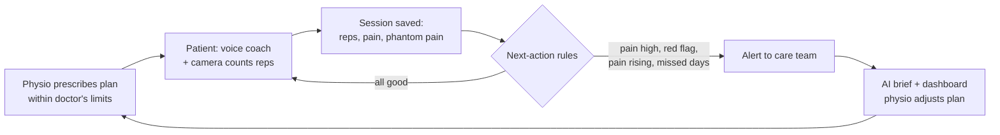

# Langkah

**An AI rehab coach that keeps amputee patients exercising at home, and keeps their doctor and physiotherapist in the loop.**

*Langkah* means "step" in Indonesian. Built by team **LifeStrong** for the AI Builders Cup.

| | |
|---|---|
| Live prototype | https://langkah-148056386681.asia-southeast2.run.app |
| Demo video | https://youtu.be/gX4cokKhzMs |
| Pitch deck | https://docs.google.com/presentation/d/1fCzmHg2XKjmZksvBDkJQzpLG14krmyDK/edit?usp=sharing |

## The problem

After an amputation, recovery depends on weeks of exercise at home: conditioning the amputated leg, preventing stiff joints, building strength before a prosthesis can be fitted. Patients get a few supervised sessions, then a sheet of exercises. Many stop, and the doctor only finds out at the next visit. Rehab specialists are scarce (Indonesia has 1,121 rehab medicine specialists for about 3,000 hospitals, mostly in Java; PERDOSRI data via the Universitas Brawijaya PM&R residency), so every visit counts. In a 2026 Ohio State survey, 76% of patients did not finish their home physiotherapy exercises.

## What Langkah does



**For the patient** (Indonesian, English or Chinese, simple words)
- A **voice coach** (Gemini Live) guides the day's exercises, asks about pain and phantom limb pain, and stops the session if the patient mentions a danger sign (wound, fall, chest pain, dizziness).
- The **camera counts reps** on the device (MediaPipe) and gives form cues ("hold a little longer"). The coach stays quiet during sets and speaks the cues.
- The coach **remembers** goals and difficulties between sessions ("you want to walk to the mosque again").
- **Skin photo check**: Gemini looks for wounds or redness on the amputated leg, or on the other foot for people with diabetes.
- After each session: a summary and a clear next step (keep going, rest and call the clinic, or ask for a check-up).

**For the care team** (rehab doctor and physiotherapist)
- Patients sorted by alerts. Alerts come from fixed rules, not AI, so they are predictable.
- An **AI brief** before each visit: adherence, pain trend, phantom pain, skin, what the patient said, points to discuss. The numbers come from the app; the doctor can edit the text.
- Plan editor: the physio changes exercises and doses; the doctor sets the pain limit and review date. Every change is a new version the patient sees next time.

**The AI never diagnoses, never suggests medicine and never changes the plan.** It explains, counts, encourages, listens for danger signs and summarises. The care team decides.

## Try it

Open the live prototype and pick a **guided scenario**. You see the patient's phone, step by step; switch on **Physio dashboard** at any point to see what the care team sees at that moment.

| Scenario | Shows | Time |
|---|---|---|
| **Pak Budi: pain is rising** (start here) | Exercise with the coach, report pain 8, the physio gets the alert, lowers the reps; the next day Pak Budi sees the new plan | 3 min |
| **Try it yourself** | Camera counts your reps while the coach talks you through a short plan | 2 min |
| **A danger sign** | "My leg is bleeding" stops the session and alerts doctor and physio | 1 min |
| **Pak Liem: missed days** | The nudge after 4 days without exercise, and the physio's alert | 1 min |
| **Before the visit** | Skin photo check, then the AI brief | 1 min |

- Every exercise step offers **Exercise with the coach** (camera and microphone) or **Simulate this session** (plays an example and saves it like a real one, so no camera is needed).
- The language switch (**EN · ID · 中文**) changes the whole app, and the voice coach speaks the chosen language.
- **Explore freely** opens every case as patient, physio or doctor, with **Next day →** to move the demo clock. **Reset demo** restores all cases. Each visitor gets their own copy of the made-up patients.

Best in Chrome on a laptop; Safari and phones work over HTTPS.

## How it uses Google Cloud

| Technology | What it does in Langkah |
|---|---|
| **Gemini Live API** | Real-time voice coach in the browser. Tool calls drive the session (`record_pain`, `start_set`, `log_set`, `report_concern`, `save_memory`, `log_diary`, `finish_session`); the app validates each call. The server mints a one-use token with the coach's instructions locked in, built from the patient's stored plan, profile and memories. |
| **Gemini (Flash)** | Care team brief from the patient's history; skin photo check with structured output (visible signs, urgency, patient message, care team note). |
| **Firebase Authentication** | Anonymous sign-in: every visitor gets an isolated demo workspace without creating an account. |
| **Firestore** | All patient data: profile, plan versions, sessions, memories, phantom pain diary, skin check results, alerts, check-ins, brief. Updates run in transactions. The browser never touches Firestore directly; rules deny all client access. |
| **Cloud Run** | Hosts the Nuxt app and its API, verifies Firebase ID tokens, runs the next-action rules and talks to Gemini. |

On the device: **MediaPipe Pose Landmarker** counts reps from the camera. Video never leaves the browser.

## Run locally

```bash
cp .env.example .env   # set NUXT_GEMINI_API_KEY; leave Firebase empty to use local files
npm ci
npm run dev            # http://127.0.0.1:3000
npm test               # rules, session, counting, pose
npm run typecheck
```

Deployment: [docs/deploy.md](docs/deploy.md).

## Repository

| Path | What |
|---|---|
| `shared/` | Code used by both browser and server: data model (`model.ts`), next-action rules, session state, coach prompt and tools, rep counting, demo cases, patient texts in three languages |
| `server/api/` | Patients, plan, sessions, alerts, check-ins, demo clock, and the AI endpoints (`live-token`, `brief`, `skin-check`) |
| `app/pages/patient/` | Patient app: home, session, summary, skin check |
| `app/pages/care/` | Care team: patient list and patient detail |
| `docs/` | [Data model](docs/data-model.md), [tasks](docs/tasks.md), [demo script](docs/demo-script.md), [submission checklist](docs/submission.md), [original plan](docs/plan.md) |

## Safety and privacy

- Made-up patients only. Not a medical device and not for real patients in this form.
- Exercise content is a draft that still needs a physiotherapist's review.
- Camera video stays in the browser. Skin photos are analysed and not stored; only the result is kept.
- Pain thresholds, alerts and next steps are plain rules in [`shared/rules.ts`](shared/rules.ts).

## Team LifeStrong

Ibrahim Yusuf (patient app and AI) · Nabila (care team app and records) · Eka (pitch, deck and video). See [docs/tasks.md](docs/tasks.md).
